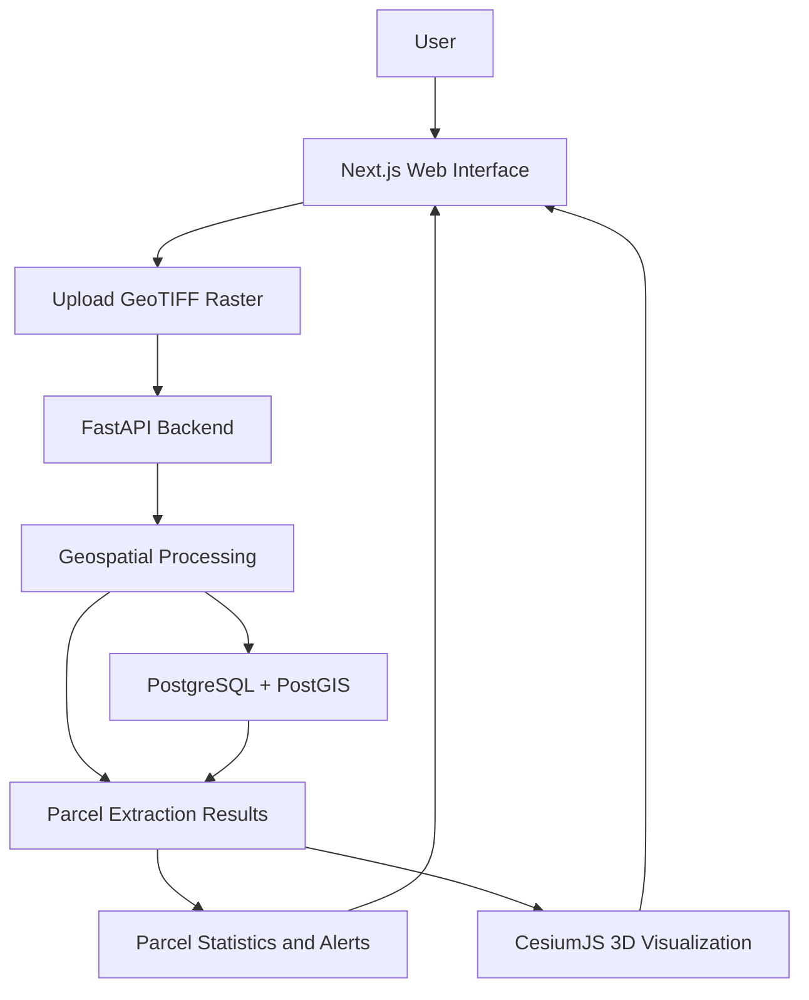

# 🏙️ AI-Based Automated Urban Parcel Mapping & 3D Cadastral Feature Extraction System

**An AI-powered geospatial platform for automated urban parcel mapping, 3D cadastral visualization, and land-encroachment analysis.**

## 📌 Overview

The **AI-Based Automated Urban Parcel Mapping and 3D Cadastral Feature Extraction System** is a geospatial technology project developed to support more efficient urban land mapping and cadastral analysis.

The system combines raster-based geospatial data processing, backend APIs, spatial database capabilities, and interactive 3D visualization to help users examine land parcels and identify potential encroachments.

By integrating aerial imagery or digital elevation data with geospatial processing, the platform aims to make urban parcel analysis more accessible, visual, and data-driven.

## 🎯 Problem Statement

Traditional land surveying and cadastral mapping workflows can involve significant manual effort, fragmented records, and challenges in identifying changes to existing land boundaries.

Urban development can also introduce potential encroachments that are difficult to inspect consistently using conventional two-dimensional mapping methods.

This project explores a technology-driven approach to:

- Automate aspects of urban parcel extraction from geospatial raster data.
- Visualize land parcels in an interactive 3D environment.
- Support the identification and analysis of potential land encroachments.
- Present parcel statistics and encroachment alerts through a unified interface.
- Improve the accessibility of geospatial information for urban planning and land administration.

## ✨ Key Features

### 🗺️ Geospatial Data Upload
- Upload drone orthomosaic or digital elevation raster files in `.tif` and `.tiff` formats.
- Send uploaded raster data to the backend for processing.
- Display a spatially positioned raster preview.

### 🧠 Automated Parcel Extraction
- Process geospatial raster inputs through the backend extraction workflow.
- Generate cadastral parcel representations from the processed data.
- Support spatial analysis of extracted parcel geometries.

### 🌐 Interactive 3D Visualization
- Visualize geospatial data using CesiumJS.
- Render extracted parcels as extruded 3D polygons.
- Display parcels with severity-based colors to help distinguish potential areas of concern.

### 🚨 Encroachment Analysis
- Present potential encroachment alerts based on processing results.
- Display parcel statistics and spatial analysis outputs.
- Support further examination of flagged areas.

*Note: Automated detection results should be treated as preliminary findings and verified against authoritative land records and applicable surveying procedures.*

## 🛠️ Technology Stack

| Component | Technology | Purpose |
|---|---|---|
| Frontend | Next.js | Web application interface |
| 3D Visualization | CesiumJS | Geospatial globe and 3D parcel rendering |
| Backend | Python, FastAPI | API endpoints and geospatial processing |
| Database | PostgreSQL with PostGIS | Spatial data storage and querying |
| Database Connectivity | SQLAlchemy / asyncpg | Asynchronous database access |
| Geospatial Inputs | GeoTIFF (`.tif`, `.tiff`) | Drone orthomosaics and elevation raster data |
| Database Hosting | Supabase | Hosted PostgreSQL/PostGIS environment |
| Containerization | Docker Compose | Multi-service development and deployment configuration |

## 🏗️ System Architecture



## 📂 Project Structure

```text
SIH26012_Project/
├── ai/
│   └── dataset/          # AI-related dataset resources
├── backend/              # FastAPI backend and processing logic
├── db/
│   └── init/             # Database initialization resources
├── frontend/             # Next.js frontend and 3D interface
├── docker-compose.yml    # Multi-service configuration
├── QUICKSTART.md         # Detailed local setup instructions
└── README.md             # Project documentation
```

## ⚙️ Prerequisites

Before running the project locally, ensure you have:

- Python 3.11 or later
- Node.js 18 or later
- npm
- A Supabase project with PostgreSQL and PostGIS available
- Git

## 🖥️ How to Use

1. Start the backend and frontend services.
2. Open the application in your browser.
3. Upload a supported drone orthomosaic or digital elevation raster.
4. Allow the backend to process the uploaded geospatial data.
5. Explore the raster preview and extracted 3D parcel representations.
6. Review the available parcel statistics and encroachment alerts.
7. Verify flagged areas against authoritative cadastral records before drawing legal conclusions.

## 🌍 Potential Applications

- **Urban Planning:** Support spatial analysis of urban development.
- **Land Administration:** Assist cadastral mapping and parcel visualization workflows.
- **Encroachment Monitoring:** Highlight locations requiring further boundary inspection.
- **Municipal Governance:** Support evidence-based review of land-use changes.
- **Geospatial Analysis:** Explore raster processing and 3D visualization in an integrated web platform.

## 🔮 Future Scope

Potential future enhancements include:

- Integrating multi-temporal imagery for land-change detection.
- Improving parcel-boundary extraction with validated AI models.
- Incorporating LiDAR and additional geospatial data sources.
- Adding confidence scores and explainable detection results.
- Integrating authoritative cadastral records and property registries.
- Developing automated reporting and GIS export functionality.
- Improving scalability, access control, and deployment automation.

These items represent potential extensions rather than confirmed existing capabilities.

## 🔐 Data and Reliability Considerations

- Protect database credentials and API secrets using environment variables.
- Validate uploaded files before processing.
- Use authoritative survey data when assessing property boundaries.
- Treat automatically flagged encroachments as indicators for further investigation, not definitive legal findings.
- Confirm the accuracy of parcel extraction against appropriate ground-truth data.

## 🤝 Contributing

Contributions and suggestions are welcome.

1. Fork the repository.
2. Create a feature branch.
3. Implement and test your changes.
4. Commit your changes with a descriptive message.
5. Open a pull request describing the changes.

## 👥 Project Information

- **Project:** AI-Based Automated Urban Parcel Mapping and 3D Cadastral Feature Extraction System
- **Project Category:** AI, GIS, Geospatial Analysis, and 3D Cadastral Mapping

## 📄 License

No license information has been confirmed here. Check the repository for an existing `LICENSE` file before specifying reuse or distribution permissions.

---

**Built to explore how AI and geospatial technology can support smarter, more transparent urban land management.**
